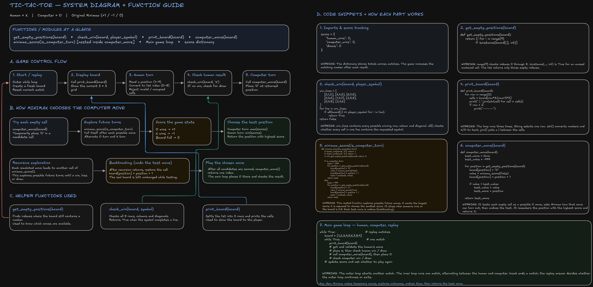

## Python Tic-Tac-Toe

### What it does
- 2-player terminal game: You play **X**, Computer plays **O**.
- AI uses **Minimax** (unbeatable).
- Tracks wins / losses / draws and loops until you press **Q**.
---
### System Diagram:



---

### Files
- `main.py` — main program
- `pngTicTacToe.excalidraw.png` — system diagram
- `demoGif.gif` — demo video

---

### How to run:
Step 1: ```bash
git clone https://github.com/RishiK-06/TicTacToe.git
```
Step 2: ```bash
cd Downloads/TicTacToe
```
Step 3:```bash
python main.py
```


---
### Methods used
1. `get_empty_positions`
2. `check_win`
3. `print_board`
4. `computer_move` (minimax)
5. Main loop with score tracking and Q-quit
