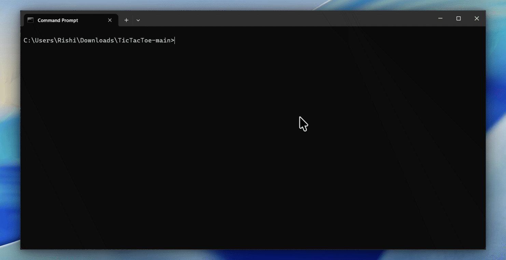

# Python Tic-Tac-Toe

A small terminal game where you play **X** against a computer **O**. It tracks your score across rounds and keeps going until you quit with **Q**.

---

## What it does

- **You vs Computer** — Human is X, AI is O
- **Hard AI** — Uses the Minimax algorithm
- **Score tracking** — Wins, losses, and draws persist across rounds
- **Play forever** — Enter `Q` at the prompt to exit

---

## How Minimax algorithm works

It simulates every possible future move from the current board:

1. **Look at all empty squares**
2. **Try each one** — temporarily place an **O** there
3. **Recurse** — give user their turn & play the best possible move user can to win
4. **Keep going** until the game ends (win, loss, or draw)
5. **Score the outcome**  
   - Computer wins → `+1`  
   - You win → `-1`  
   - Draw → `0`
6. **Backtrack** — the computer picks the move that leads to the highest score (assuming you also play your best moves to minimize its score)

Because the game tree for tic-tac-toe is tiny, this runs instantly. The result is: the AI never looses.

---

## How to play

Run it:
```bash
python main.py
```

You'll see a board numbered 1–9:
```
1 | 2 | 3
--+--+--
4 | 5 | 6
--+--+--
7 | 8 | 9
```

- Type a number (1–9) and press **Enter** to place your **X**
- Invalid input or taken squares are ignored — just try again
- After your move, the computer instantly replies with **O**
- Game ends when someone gets three in a row, or the board fills (draw)
- Score is printed, then you're asked: `Play again? (Q to quit):`
- Press **Enter** to play another round, or type **Q** / **quit** to exit

---

## Files

| File | Purpose |
|------|---------|
| `main.py` | Game logic, Minimax AI, score loop |
| `pngTicTacToe.excalidraw.png` | System diagram (open in Excalidraw or view directly) |
| `demoGif.gif` | Short demo of gameplay |

---

## Methods used

1. `get_empty_positions(board)` — returns list of open indices
2. `check_win(board, symbol)` — checks all 8 win lines
3. `print_board(board)` — renders the 3×3 grid
4. `easy_computer_move(board)` — easy mode where user can play to win using random module
6. `hard_computer_move(board)` — hard mode using minimax algorithm which checks every possible future outcome before making a move
5. Main loop — handles input, updates board, checks win/draw, tracks score, asks to replay

---

## System Diagram


---

## Demo



---

## Contributors

| Contributor | Role |
|-------------|------|
| [@Rishi](https://github.com/Rishi) | Minimax algorithm, README, Demo, System design, Main method |
| [@Sneha](https://github.com/Sneha-DSA) | CheckWin function, PrintBoard function, Random difficulty |

